<div align="center">

  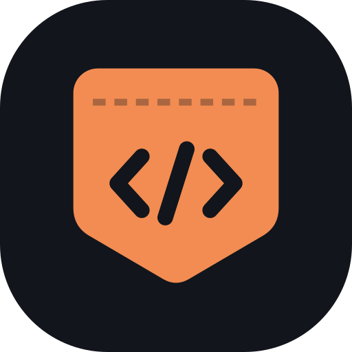

  # PocketCode

  ### *A complete AI coding workspace in your pocket.*

  **Chat with coding agents, edit code, run real Linux commands, and preview web servers, all on your Android phone.**

  <br />

  [](#system-requirements)
  [](#system-requirements)
  [](#architecture)
  [](LICENSE)

  <br />

  [**Download**](#download) &nbsp;•&nbsp;
  [**What's new**](#whats-new-in-pocketcode) &nbsp;•&nbsp;
  [**Quickstart**](#quickstart) &nbsp;•&nbsp;
  [**Architecture**](#architecture) &nbsp;•&nbsp;
  [**Build from source**](#developer-guides)

</div>

<br />

<table>
  <tr>
    <th width="25%" align="center">Projects</th>
    <th width="25%" align="center">Agent chat</th>
    <th width="25%" align="center">Code viewer</th>
    <th width="25%" align="center">Files</th>
  </tr>
  <tr>
    <td align="center" valign="top">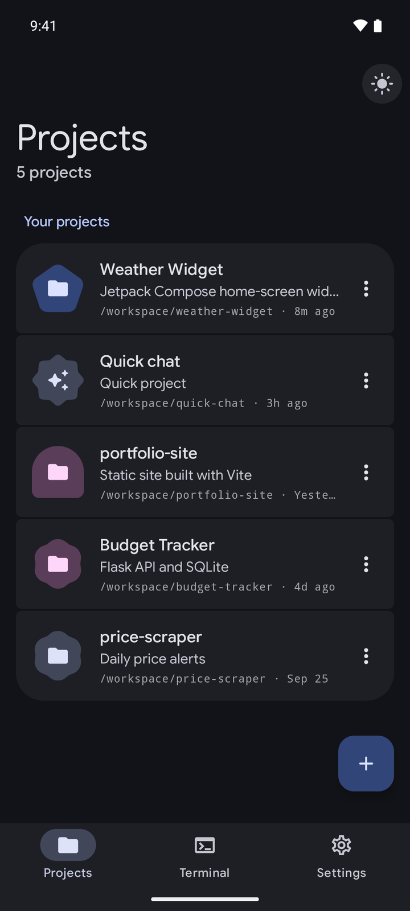</td>
    <td align="center" valign="top">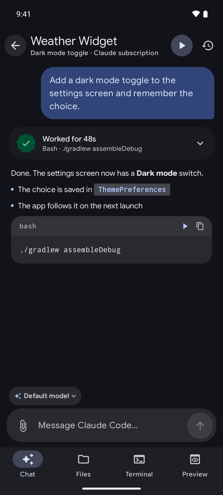</td>
    <td align="center" valign="top">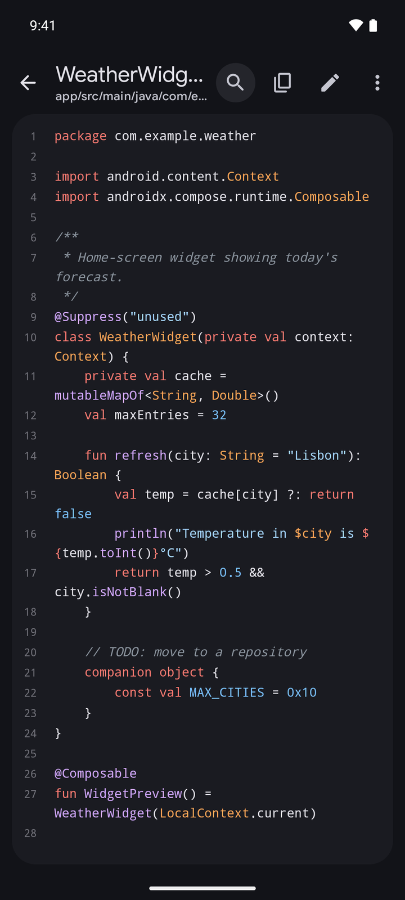</td>
    <td align="center" valign="top">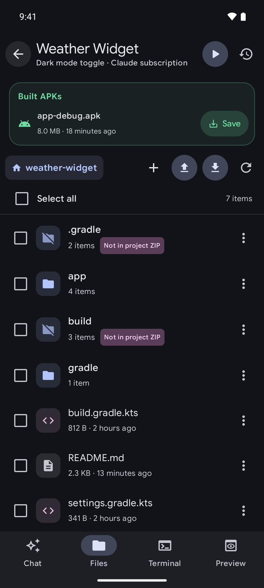</td>
  </tr>
</table>

> [!IMPORTANT]
> **Security notice**
> PocketCode runs on **ARM64 Android devices** inside a private userspace PRoot layer. Android's app sandbox keeps it apart from other apps, but PRoot is not a virtual machine or a hardened jail. Only run projects and dependencies you own or trust.

<br />

## What's new in PocketCode

PocketCode started as a fork of [Mobile Harness](https://github.com/techjarves/Mobile-Harness). Since then the app has been redesigned from the ground up, and a lot has been added:

* **Material 3 Expressive redesign.** New theme with spring motion, shape morphing and Google Sans Flex. It uses your wallpaper colors on Android 12+ (brand orange on older phones) and follows the system dark/light setting.
* **Code editor with syntax highlighting.** It supports 37 languages and file formats, with find & replace, go to line, undo/redo, toggle comment, auto-indent, auto-closing quotes, word wrap and adjustable font size, plus a key row with Tab, outdent, comment and cursor keys.
* **Safe file editing.** You get a prompt for unsaved changes, and a check that the file didn't change on disk while it was open. Saves are atomic, keep CRLF line endings, and leave binary, oversized or non-UTF-8 files read-only.
* **Full file management.** Upload files into any folder, with Replace / Keep both / Skip when names clash. Create files and folders, rename, delete, or save to your device.
* **ZIP import and export.** Export any mix of files and folders, or the whole project, as a ZIP. Build outputs and caches are left out unless you ask for them. ZIP attachments in chat can be extracted into the project or imported as a new project.
* **Sign in with your Claude subscription.** Use Claude Pro, Max, Team or Enterprise through the official `claude setup-token` flow. No API key needed.
* **Built APKs card.** Save Android builds straight from the Files tab.
* **New first-run flow.** A welcome page, then permission steps that open the right system settings in one tap.
* **Sessions keep running.** Pressing Back on a home screen sends the app to the background instead of closing it, so a running agent isn't interrupted.

<br />

## Features

PocketCode pairs a native **Jetpack Compose** app with a self-contained **Ubuntu 20.04 subsystem**. You get a real development environment on your phone without root, an unlocked bootloader, or apps like Termux.

<table>
  <tr>
    <td width="50%" valign="top">
      <h3>AI coding agents</h3>
      <p>Built-in support for Claude Code, DeepSeek Harness and Antigravity CLI. Each agent has its own driver and settings, and project conversations you can resume.</p>
    </td>
    <td width="50%" valign="top">
      <h3>Real Linux environment</h3>
      <p>A full Ubuntu 20.04 ARM64 userspace running in PRoot, with Node.js, npm, Git, OpenSSL and the usual shell tools included.</p>
    </td>
  </tr>
  <tr>
    <td width="50%" valign="top">
      <h3>Code editor</h3>
      <p>Read and edit project files with syntax highlighting, search and replace, and a key row made for touch typing code.</p>
    </td>
    <td width="50%" valign="top">
      <h3>File management</h3>
      <p>Browse with breadcrumbs, select anything, upload, rename, delete, and export as ZIP. Files move to and from your phone through Android's Storage Access Framework.</p>
    </td>
  </tr>
  <tr>
    <td width="50%" valign="top">
      <h3>Live web preview</h3>
      <p>Start a Vite, Next.js or Express server and try it in a sandboxed in-app WebView with console output.</p>
    </td>
    <td width="50%" valign="top">
      <h3>Encrypted credentials</h3>
      <p>API keys and tokens are encrypted with Android Keystore-backed AES-256-GCM. No telemetry and no relay servers.</p>
    </td>
  </tr>
  <tr>
    <td width="50%" valign="top">
      <h3>On-device Android builds</h3>
      <p>Build, install and launch Android APKs right on the phone. No USB or wireless ADB pairing.</p>
    </td>
    <td width="50%" valign="top">
      <h3>Optional toolchains</h3>
      <p>Add Python, Android, C/C++ and PHP tooling only when a project needs it.</p>
    </td>
  </tr>
</table>

<br />

## A closer look

### Workspace

<table>
  <tr>
    <th width="25%" align="center">Approvals</th>
    <th width="25%" align="center">Terminal</th>
    <th width="25%" align="center">Preview</th>
    <th width="25%" align="center">Settings</th>
  </tr>
  <tr>
    <td align="center" valign="top">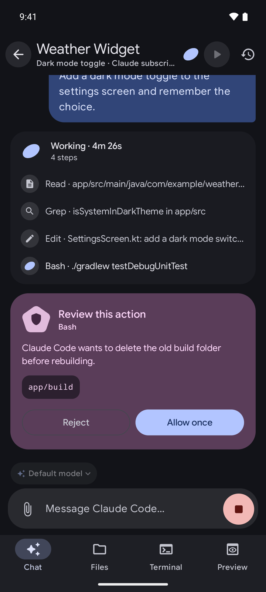</td>
    <td align="center" valign="top">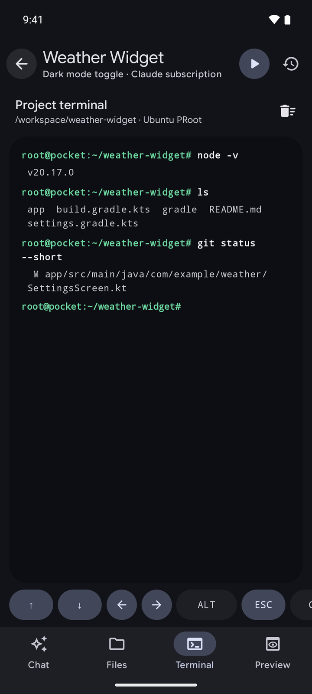</td>
    <td align="center" valign="top">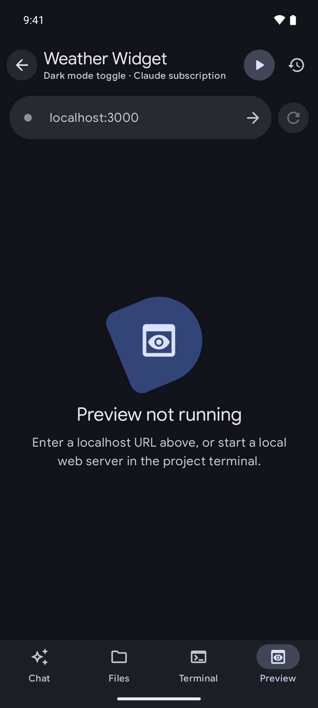</td>
    <td align="center" valign="top">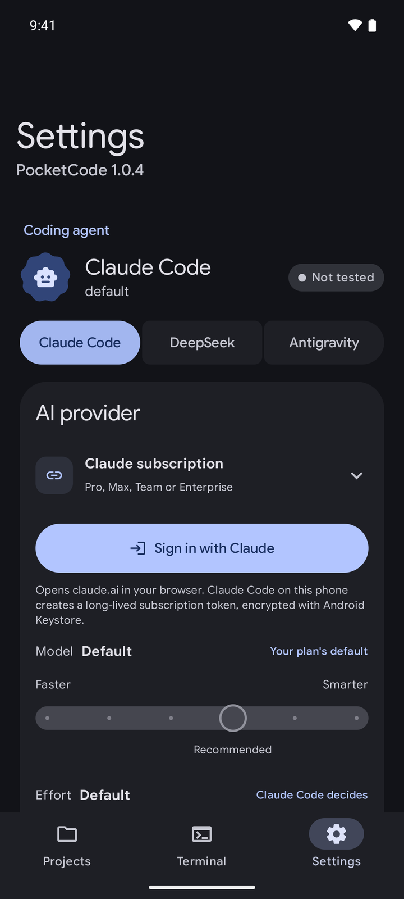</td>
  </tr>
  <tr>
    <td align="center"><sub>Risky actions wait for your OK while the agent's steps stream in.</sub></td>
    <td align="center"><sub>Run real commands in the project folder, with a key row for special keys.</sub></td>
    <td align="center"><sub>Open any localhost server the project starts.</sub></td>
    <td align="center"><sub>Pick your coding agent, provider, model and effort.</sub></td>
  </tr>
</table>

### Setup

<table>
  <tr>
    <th width="33%" align="center">Welcome</th>
    <th width="33%" align="center">Device check</th>
    <th width="33%" align="center">Claude sign-in</th>
  </tr>
  <tr>
    <td align="center" valign="top">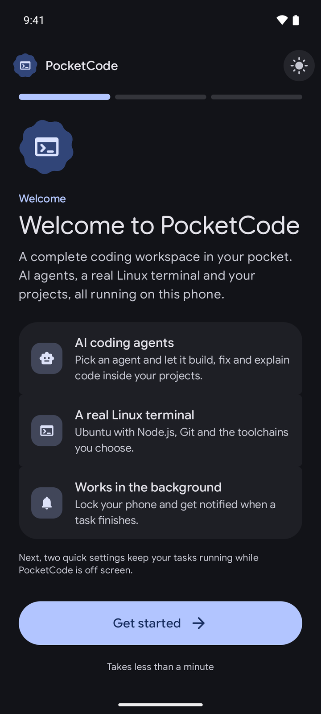</td>
    <td align="center" valign="top">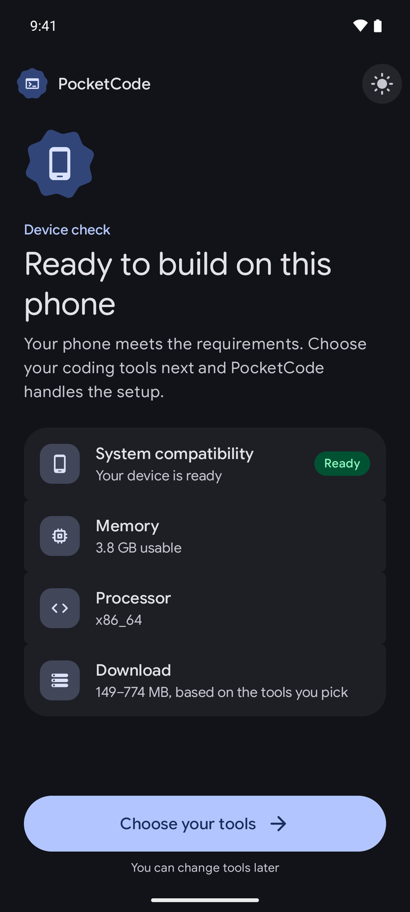</td>
    <td align="center" valign="top">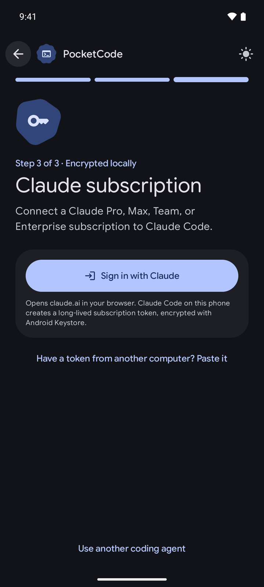</td>
  </tr>
  <tr>
    <td align="center"><sub>A short tour, then two quick settings that keep tasks running in the background.</sub></td>
    <td align="center"><sub>Checks your phone and shows the download size for the tools you pick.</sub></td>
    <td align="center"><sub>Connect a Claude subscription or an API key.</sub></td>
  </tr>
</table>

### Light theme

<table>
  <tr>
    <td width="25%" align="center" valign="top">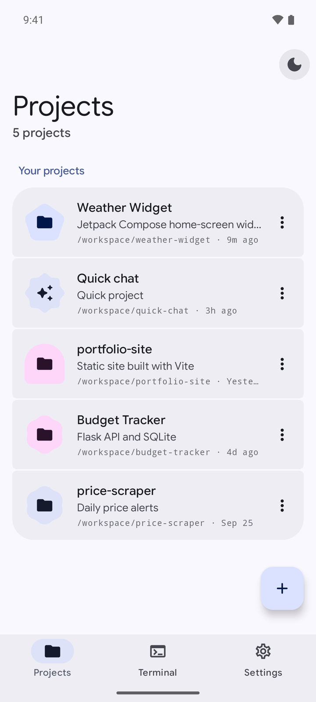</td>
    <td width="25%" align="center" valign="top">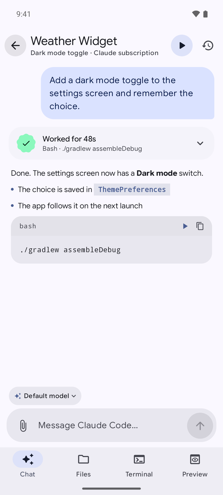</td>
    <td width="25%" align="center" valign="top">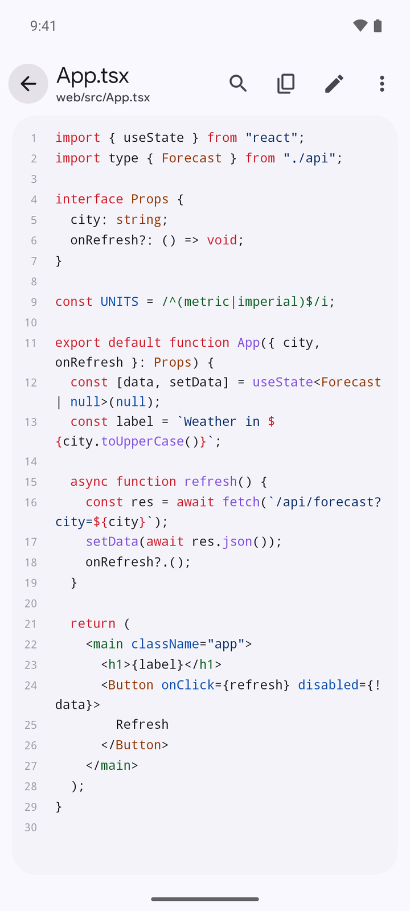</td>
    <td width="25%" align="center" valign="top">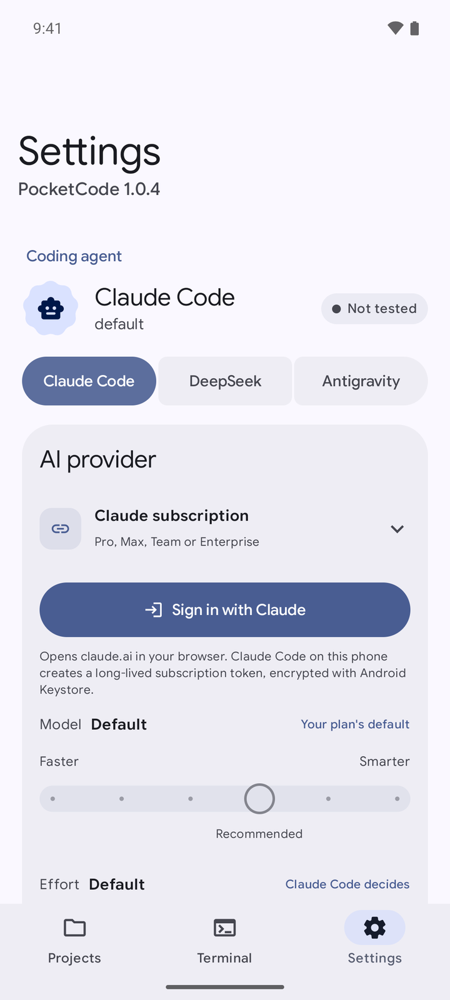</td>
  </tr>
</table>

<br />

## Download

Get the latest signed APK from [**GitHub Releases**](https://github.com/NinoCK/PocketCode/releases/latest). There are two editions:

| Edition | Best for | What's inside |
| :--- | :--- | :--- |
| **Online** | Most people | The smaller APK. The Core, Python and Android runtime bundles download only when needed. |
| **Offline** | Limited or no internet during setup | The runtime bundles are included in the APK. |

<p align="center">
  <strong>ARM64 Android 9+</strong><br />
  <sub>Direct APK install · No root · No USB or wireless ADB pairing</sub>
</p>

<br />

## Quickstart

### 1. Install
Download the APK from [Releases](https://github.com/NinoCK/PocketCode/releases/latest) and open it. Android will ask you to allow installs from your browser or file manager.

```text
Architecture : ARM64 (arm64-v8a)
Minimum OS   : Android 9.0 (API 28)
```

### 2. Run the guided setup (about 10 minutes)
1. **Welcome:** a quick look at what PocketCode does.
2. **Background tasks:** turn on notifications and remove battery limits, so agents keep working with the screen off.
3. **Device check and tools:** PocketCode checks your phone, then you pick optional toolchains (Python, Android, and more).
4. **Install:** the Ubuntu runtime and your tools download and are verified.
5. **Coding agent:** sign in with Claude, or add an API key for another provider.

### 3. Start building
1. Tap **+** to create a project, start a quick chat, import a ZIP, or clone a Git repository.
2. Describe what you want in the chat.
3. Watch the agent read files, write code, run builds and start local web previews. Step in whenever it asks for approval.

<br />

## Model providers

PocketCode uses Claude Code's Anthropic-compatible API protocol. You can connect official endpoints or route requests through compatible gateways:

| Provider | Integration | Streaming | Tool calling | Status | Notes |
| :--- | :---: | :---: | :---: | :---: | :--- |
| **Anthropic API** | API key | Supported | Supported | `Recommended` | Primary supported backend |
| **Claude subscription** | Sign in with Claude | Supported | Supported | `Supported` | Pro, Max, Team or Enterprise plan |
| **OpenRouter** | Gateway | Supported | Supported | `Supported` | Many compatible models through one API key |
| **DeepSeek** | API key | Supported | Supported | `Supported` | Anthropic-compatible endpoint |
| **Kimi** | API key | Supported | Supported | `Supported` | Anthropic-compatible Moonshot endpoint |
| **Custom API** | Endpoint override | Compatible | Compatible | `Experimental` | Your own gateway |

> [!NOTE]
> API keys and tokens are stored with hardware-backed Android Keystore AES-256-GCM encryption. Antigravity's Google OAuth credentials are created and kept only by the official `agy` CLI in its Linux home folder; PocketCode never reads or copies them.

### Coding agents

| Agent | Sign-in | Installation | Isolation |
| :--- | :--- | :--- | :--- |
| **Claude Code** | Claude subscription or API-key providers | Included in Core | Its own bridge and settings |
| **DeepSeek Harness** | API-key providers | On demand | Its own bridge and settings |
| **Antigravity CLI** | Official Google OAuth flow | Version-pinned download | Its own `agy` bridge, model, effort and conversation IDs |

**Claude subscription.** Choose **Claude subscription** and tap **Sign in with Claude**. PocketCode runs the official `claude setup-token` command on the phone and opens the sign-in page in an in-app browser tab (Chrome Custom Tab). Once you approve, claude.ai redirects back to Claude Code's own listener on `127.0.0.1`. Claude Code then creates a one-year subscription token, which PocketCode stores with Android Keystore encryption. If the browser can't return to the app, tap **Sign in with a code instead** and paste the code from the Claude page. You can also paste a token you made with `claude setup-token` on another computer.

**Antigravity.** Select **Antigravity CLI**, install it, and tap **Sign in with Google**. PocketCode starts the official CLI login, opens the Google URL it generates in your system browser, and passes the one-time code back to the waiting process. Google login is never embedded in a WebView, and PocketCode never builds its own OAuth request.

> [!WARNING]
> Antigravity tasks currently launch with `--dangerously-skip-permissions`, so the agent can run tools without asking you first. Use it only with projects and prompts you trust. Account quotas and service limits still apply.

**Android projects.** If you pick Android during setup, PocketCode installs the full toolchain into its private Ubuntu environment. Tap the play button in a workspace to build. The debug APK goes straight to Android's package installer and launches once installed. You don't need USB debugging, wireless debugging or a pairing code, but Android still asks you to allow installs from PocketCode and to confirm each one.

<br />

## Architecture

PocketCode connects the native Jetpack Compose app to an isolated PRoot Linux layer through a C++ JNI bridge:

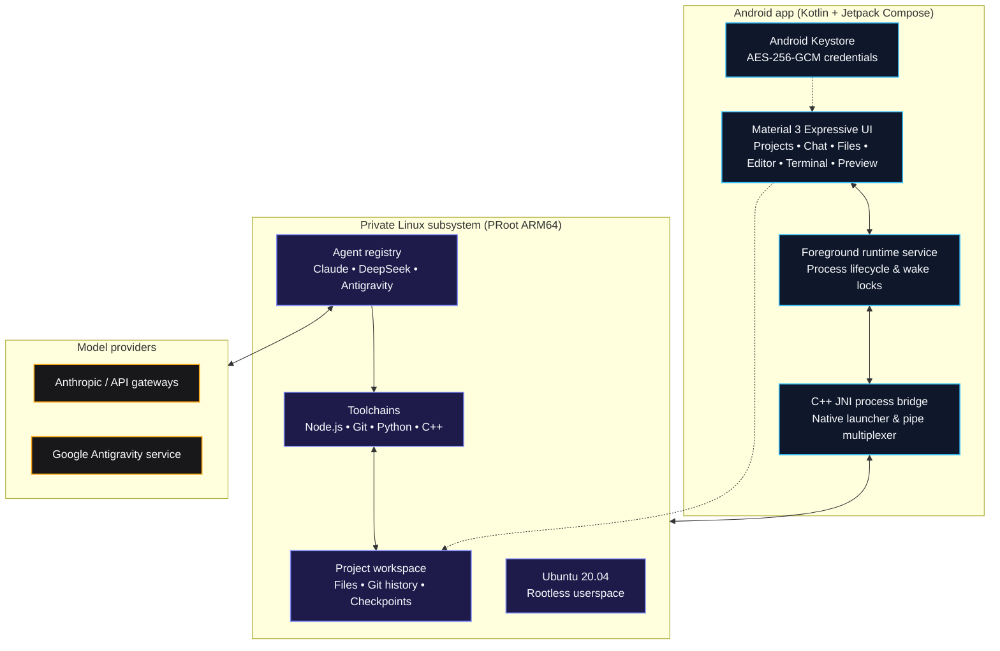

### Core runtime
* **Base environment:** verified Ubuntu 20.04 ARM64 rootfs
* **Agents:** separate drivers for Claude Code, DeepSeek Harness and the official Antigravity CLI
* **Tools:** Node.js LTS, npm, Git, OpenSSL, curl and GNU coreutils
* **Process layer:** PRoot userspace, no kernel changes

<br />

## System requirements

| | Minimum | Recommended |
| :--- | :--- | :--- |
| **Android** | 9.0 (API 28) | 13.0+ (API 33+) |
| **CPU** | 64-bit ARM (`arm64-v8a`) | Fast 8-core ARM64 (Snapdragon 8 Gen 1+ / Dimensity) |
| **RAM** | 4 GB | 8 GB or more |
| **Free storage** | 2.5 GB (base runtime) | 8 GB+ (extra toolchains and build caches) |
| **Network** | Stable connection for setup and API calls | Fast Wi-Fi for the first runtime download |

<br />

---

## Developer guides

<details>
<summary><b>Building from source (Android Studio & NDK)</b></summary>

<br />

### Prerequisites
* **Android Studio**: Narwhal 3 Feature Drop or newer (AGP 8.13)
* **Android SDK**: API 36 (`compileSdk 36`)
* **JDK**: 17 (Eclipse Temurin or OpenJDK)
* **Android NDK**: `26.1.10909125`
* **CMake**: `3.22.1`

### Clone and build a debug APK
```bash
# Clone with the native submodules (proot, libandroid-shmem)
git clone --recursive https://github.com/NinoCK/PocketCode.git
cd PocketCode

# Build the Online edition
./gradlew assembleOnlineDebug

# Install on a connected device
adb install -r app/build/outputs/apk/online/debug/app-online-debug.apk
```

The Offline edition (`assembleOfflineDebug`) also needs the runtime bundles in `dist/runtime-bundles/`.

### Tests and lint
```bash
./gradlew testOnlineDebugUnitTest
./gradlew lintOnlineDebug
```

### UI gallery
Debug builds include a screen gallery that renders every screen with sample data, with no Linux runtime needed. The screenshots in this README come from it:
```bash
adb shell am start -n io.github.ninock.pocketcode/.ui.UiGalleryActivity --es screen projects --es theme dark
```
See `app/src/debug/java/io/github/ninock/pocketcode/ui/UiGalleryActivity.kt` for the list of screens.

### Build targets
* **Direct APK** (default): targets API 28 to keep the proven userspace execution paths working on Android 10–14.
* **Google Play build**:
  ```bash
  ./gradlew -PplayBuild=true assembleOnlineDebug
  ```
  See the [Google Play release checklist](docs/PLAY_STORE_CHECKLIST.md) for signing and permission policies.

</details>

<details>
<summary><b>Optional toolchains</b></summary>

<br />

Developer packs download on demand to save space:

* **Python:** Python 3.10+, pip, virtualenv and common scientific C extensions.
* **Android & JVM:** OpenJDK 17 headless and the Gradle build tools.
* **C / C++:** GCC/G++, Clang, Make and CMake.
* **PHP:** PHP CLI, Composer and standard database extensions.

> *Docker, KVM, systemd services and nested emulators aren't supported under PRoot.*

</details>

<details>
<summary><b>Repository layout</b></summary>

<br />

```text
PocketCode/
├── app/src/main/
│   ├── java/io/github/ninock/pocketcode/
│   │   ├── data/       # Preferences, Keystore encryption, persistence
│   │   ├── model/      # Projects, chats, files, tool calls
│   │   ├── runtime/    # PRoot installer, agent bridges, foreground services
│   │   └── ui/         # Compose screens, Material 3 Expressive theme, ViewModels
│   │       └── editor/ # Code editor: lexers, syntax colors, search, editing
│   ├── cpp/            # Native launcher and pipe handler
│   ├── assets/         # Rootfs checksums, licenses, base configuration
│   └── res/            # Icons and drawables
├── app/src/debug/      # UI gallery for screenshots and visual checks
├── third_party/        # proot, libandroid-shmem, talloc
├── fastlane/           # Store metadata and graphics
└── docs/               # Play Store review notes and update testing
```

</details>

<details>
<summary><b>Security model and privacy</b></summary>

<br />

* **No middlemen:** PocketCode talks straight to the AI endpoint you choose. No relay or telemetry server sees your prompts or code.
* **Scoped storage:** imports and exports go through Android's Storage Access Framework instead of broad storage access.
* **Checksums:** rootfs archives and Claude Code CLI packages are verified with SHA-256 before extraction.
* **Encrypted secrets:** API keys and tokens are encrypted in hardware-backed Android Keystore.
* **Guarded file operations:** saves go through a temp file and an atomic move, deletes never follow symlinks, ZIP extraction is protected against zip-slip, and paths outside the project are refused.

Read the full [privacy policy](PRIVACY.md).

</details>

PocketCode is meant for direct APK distribution. Its Android build workflow asks permission to send user-built APKs to Android's package installer, which needs a separate Google Play policy declaration and approval if the app is distributed on Play.

<br />

## Current limitations

* **Architecture:** 64-bit ARM (`arm64-v8a`) only.
* **Isolation:** PRoot maps files and IDs in userspace. It isn't a hardened container or VM, so don't run hostile code.
* **Terminal:** the process bridge handles normal CLI work and REPLs, but it isn't a full PTY. Full-screen ncurses programs may draw incorrectly.
* **Background work:** Android may throttle heavy builds under battery optimization. Exempt PocketCode from battery optimization in system settings.
* **Speed:** large builds can be slow and memory-hungry under PRoot.
* **Downloads:** the runtime needs a sizeable download and free storage, and Gradle may still fetch project-specific Android libraries that aren't in the bundled Maven cache.
* **Custom providers:** some may lack Claude-compatible thinking, tool use, token counting or streaming.

<br />

## Credits

PocketCode is built on [**Mobile Harness**](https://github.com/techjarves/Mobile-Harness) by [Tech Jarves](https://github.com/techjarves), released under the MIT License. The Linux runtime, agent bridges and native launcher come from that project. Thank you for open-sourcing it.

It also builds on [PRoot](https://github.com/termux/proot) and [libandroid-shmem](https://github.com/termux/libandroid-shmem) from the Termux project, and [talloc](https://talloc.samba.org/) from Samba.

<br />

## Legal & trademarks

* PocketCode is an independent open-source project. It is not affiliated with, endorsed by, or sponsored by Anthropic or Google.
* **Claude** and **Claude Code** are trademarks of Anthropic, PBC. The Claude Code CLI is downloaded from Anthropic's official distribution endpoints during setup and is governed by Anthropic's license terms.
* Ubuntu, Android, Kotlin, Node.js, Git and other trademarks belong to their respective owners.
* Third-party open-source licenses are collected in [`app/src/main/assets/licenses`](app/src/main/assets/licenses).

<br />

## License

PocketCode is released under the [MIT License](LICENSE). The original Mobile Harness copyright notice is kept in that file, as the license requires. Third-party binaries and packages stay under their own upstream licenses: PRoot is GPL-2.0, talloc is LGPL-3.0, and libandroid-shmem is BSD.

<br />

---

<div align="center">
  
  <br />
  <sub>PocketCode · Built for coding wherever you are.</sub>
</div>
